# 우체국 가는 길 (Postal Access Atlas)

전국 우체국 시설(우정사업본부 「우체국 찾기」)을 인구·행정구역(SGIS·KOSIS), 은행·약국·병의원, 날씨·대기, 공휴일 자료와
**공간 결합**해 "우체국까지 얼마나 먼가, 우체국이 닫히면 누가 무엇을 잃는가"를 계산하고 보여 주는 로컬 분석 플랫폼입니다.

- **접근성 지표** — 최근접 금융 우체국 거리(직선·도로), 집계구 인구 가중 거리, 2km 밖 인구·고령인구, 금융 공백 인구
- **생활 거점** — 약국·의원·은행과 함께 판정해 **우체국이 동네의 마지막 필수 거점**인 곳과 **닫히면 대신할 곳이 없는 우체국**
- **What-if · 배치 제안** — 우체국이 문을 닫으면 멀어지는 사람과 **생활 거점을 모두 잃는 사람**, 닫거나 열 때 영향이 작거나 효과가 큰 곳
- **은행이 문을 닫으면** — 은행 지점 5,425곳마다 이용 주민과, 닫히면 다른 은행·**은행 업무를 하는 우체국**까지 얼마나 멀어지는지
  (2026 은행 점포폐쇄 공동절차 개정·우체국 은행대리업 반영, 등급 BANK-IMPACT-1)
- **걸어서** — OpenStreetMap 보행 도로망으로 집계구마다 고령자 걸음(0.8m/s) 기준 금융 우체국·은행까지 걷는 거리. 전국 37.5% 가 30분 안에 못 닿음
- **지역 한 장 보고서** — 시군구 하나의 접근성·도보·지켜야 할 우체국·은행 지점 영향·읍면동 지도·방문 여건을 한 장에, 인쇄·PDF
- **방문 여건 · 영업일** — 기상청·에어코리아 예보로 오늘~모레 방문이 어려운 지역, 공휴일·연휴엔 창구 휴무와 365코너·휴일 진료 공백
- **데이터·운영** — 오류 로그(한곳에 모아 복사·새로 고침, 해결한 항목 지우기), 작업 큐·스케줄·품질 검사·원본 응답(키 마스킹)을 모두 기록

**엔지니어링**: Postgres 작업 큐(`SKIP LOCKED` + `LISTEN/NOTIFY`) — **short·long 차선**으로 긴 수집이 예보 갱신을 막지 않고,
무거운 작업은 **자식 프로세스**(끝나면 메모리 반환), 워커 생존 신호·DB 끊김 자동 복구 · **k-최근접 다중 출발 다익스트라**(OSM 447만 꼭짓점,
집계구 10만 곳 51초) · 사분할 격자 **전수 수집** · 마이그레이션 전용 단계 · 최소 권한 DB 역할 · 속도 제한·CSP(+위반 보고 수집)·
비루트/읽기 전용 컨테이너 · 측정 기반 최적화(`make bench`, 주요 경로 p50 2.6~16배 개선) · Prometheus 지표 · 백업/복원 ·
CI(테스트 306개·React Hook 린트, pip-audit·npm audit·gitleaks·이미지 빌드).

**품질 검증**: API 퍼징 658건 5xx 0 · 실패 주입 7개 상황 · 11개 화면 상호작용 크롤링 오류 0 · axe-core 접근성 위반 0 · Lighthouse 모바일 중앙값 ·
`make qa` 로 다시 돌림 — 결과와 찾아서 고친 문제는 [품질 검증](docs/quality.md).

문서: [아키텍처](docs/architecture.md) · [설계 결정·API·데이터 구조](docs/README.md) · [품질 검증](docs/quality.md) ·
[벤치마크](docs/benchmarks.md) · [변경 이력](docs/CHANGELOG.md)

> ⚠ 이 서비스의 지표는 이 프로젝트가 정의한 **분석용 지표이며 공식 통계가 아닙니다.** 거리는 직선거리입니다(도로·도보 지표 제외).
> 은행 지점 영향평가는 공식 사전영향평가가 아닌 분석용 평가입니다.

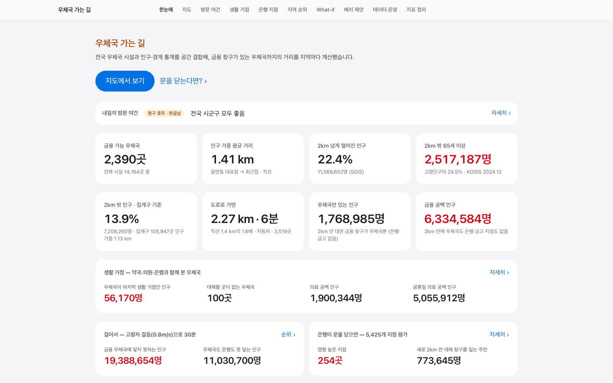

<table>
<tr>
<td width="50%">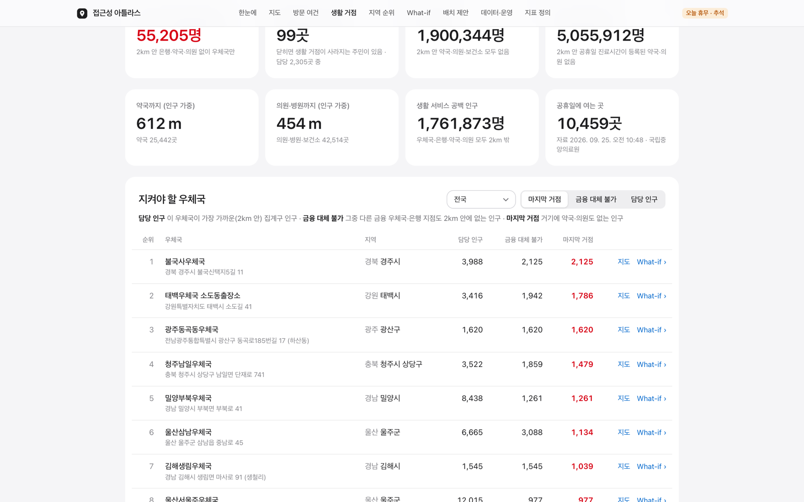<br><sub><b>생활 거점</b> · 우체국이 마지막 생활 거점인 인구, 닫히면 대신할 곳이 없는 우체국 순위</sub></td>
<td width="50%">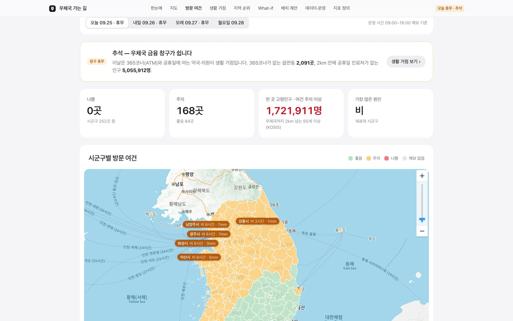<br><sub><b>방문 여건</b> · 추석 연휴 — 창구 휴무, 365코너 없는 읍면동·공휴일 진료 공백</sub></td>
</tr>
<tr>
<td>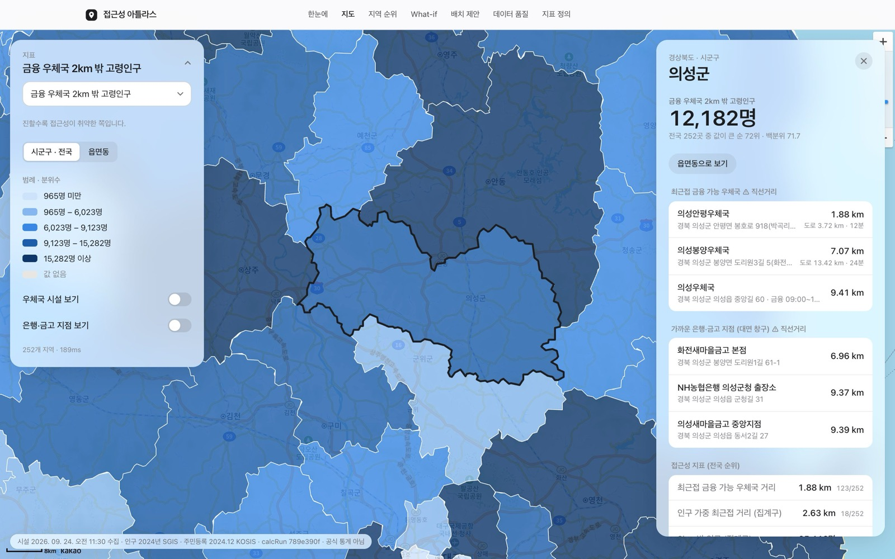<br><sub><b>지도</b> · 시군구 단계구분도 + 지역 카드(오늘~모레 방문 여건·휴무 포함)</sub></td>
<td>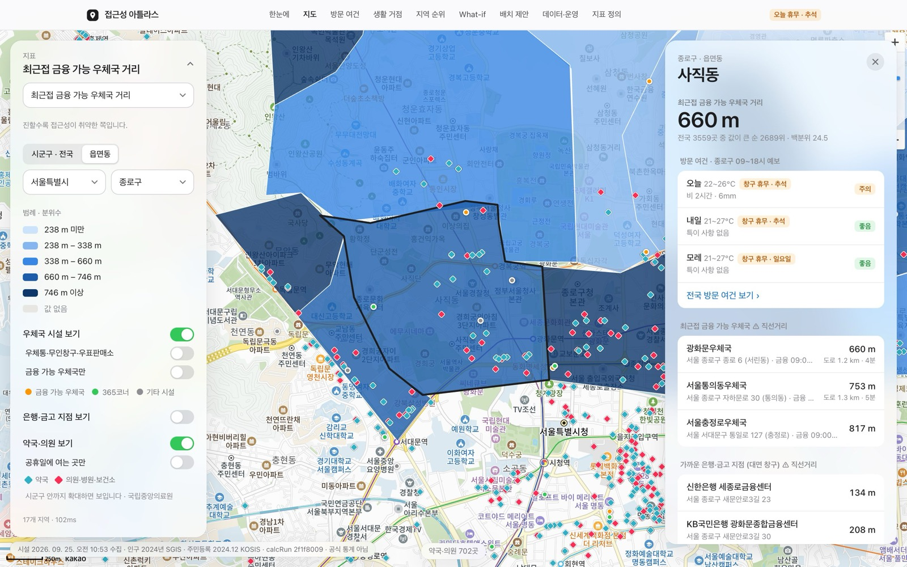<br><sub><b>지도</b> · 읍면동 + 우체국 시설 · 약국·의원 레이어</sub></td>
</tr>
<tr>
<td>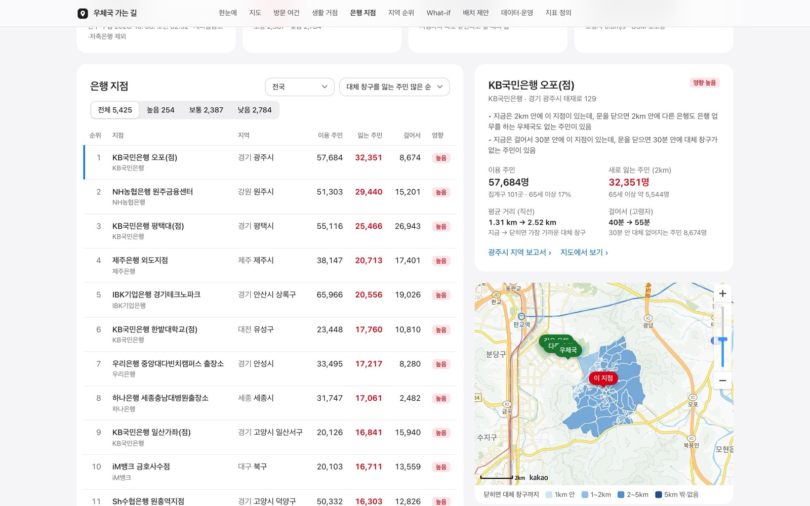<br><sub><b>은행 지점</b> · 지점마다 이용 주민·닫히면 대체 창구까지 거리·새로 잃는 주민·등급, 이용 주민 집계구 지도</sub></td>
<td>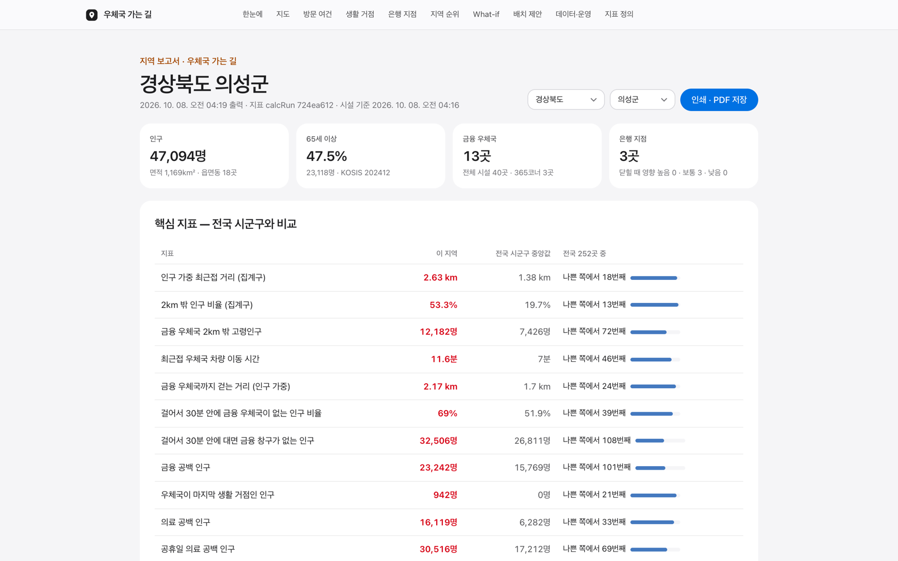<br><sub><b>지역 보고서</b> · 시군구 한 장 — 전국 중앙값 비교·읍면동 SVG 지도·지켜야 할 우체국·은행 지점 영향(인쇄·PDF)</sub></td>
</tr>
<tr>
<td>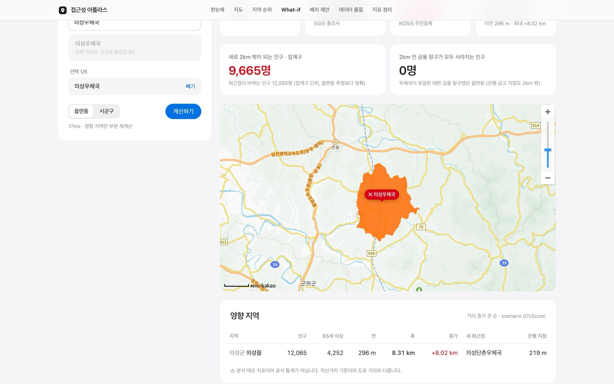<br><sub><b>What-if</b> · 닫힌다면 — 영향 인구·늘어나는 거리·생활 거점 상실</sub></td>
<td>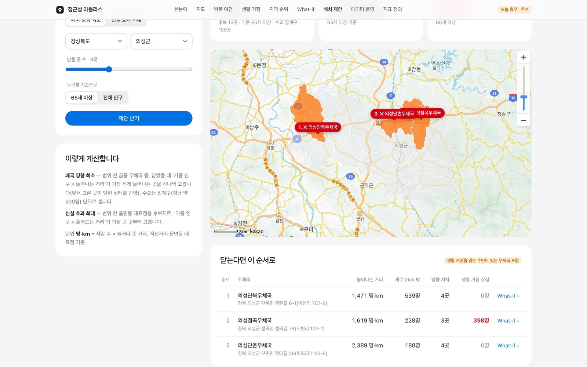<br><sub><b>배치 제안</b> · 영향이 작은 순서 + 생활 거점을 잃는 주민 경고</sub></td>
</tr>
<tr>
<td>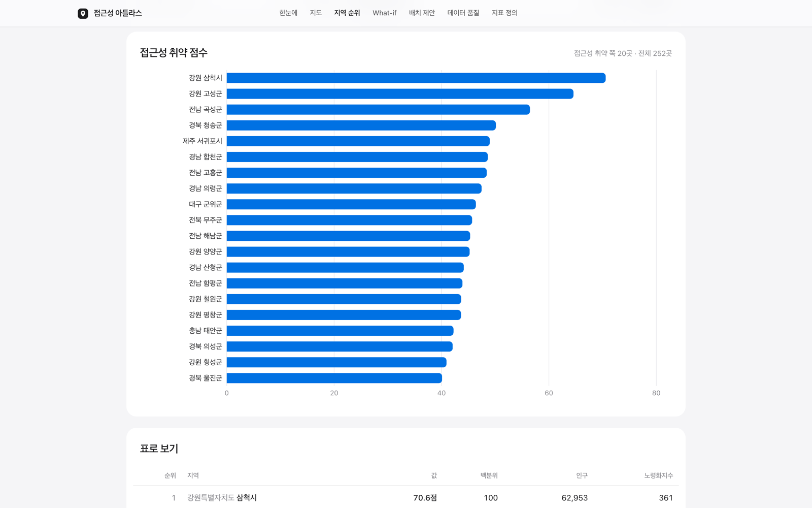<br><sub><b>지역 순위</b> · 주제별 지표, 조건은 주소에 저장(공유 가능)</sub></td>
<td>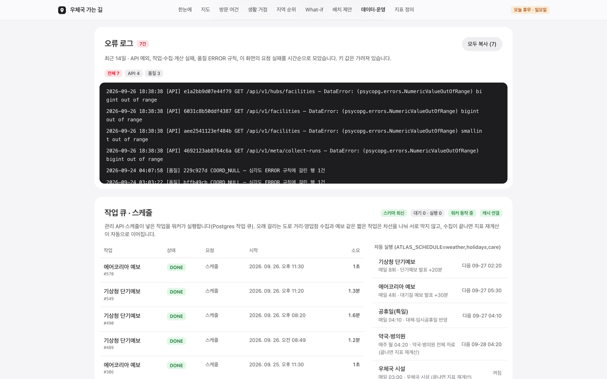<br><sub><b>데이터·운영</b> · 한 줄 오류 로그(복사) · 작업 큐·워커 차선 상태·자동 실행 스케줄</sub></td>
</tr>
</table>

<sub>로컬 실데이터로 찍었습니다(2026-09-25 추석 · 은행 지점·보고서 2026-10-08). 다시 찍기: 서비스를 띄운 상태에서 `pip install playwright && python scripts/capture_screens.py`.</sub>

---

## 1. 처음 실행하기 (맥, Docker Desktop 필요)

```bash
cd ~/Projects/postal-access-atlas
cp .env.example .env        # 키 입력 (make up 이 .env 가 없으면 만들고 ADMIN_TOKEN·API_DB_PASSWORD 를 생성)
make up                     # db·redis → migrate(스키마·역할) → api·worker·web
make smoke                  # 키가 실제로 동작하는지 확인 (응답은 fixtures/ 에 마스킹 저장)
make all-data               # 지역코드 → 우체국 → SGIS → KOSIS → 집계구·은행 전수·도로·좌표검증·약국/병의원·공휴일·OSM → 계산(+도보) → 예보 (처음 약 1시간)
open http://localhost:3100/overview
```

이후 예보·공휴일·약국/병의원은 **워커가 자동으로** 갱신합니다(3장). `.env` 에 넣는 값 — 값만 쓰고 **줄 끝 주석은 달지 마세요**:

| 변수 | 발급처 | 필수 | 용도 |
|---|---|---|---|
| `POST_SERVICE_KEY` | 우정사업본부 「우체국 찾기」 OpenAPI 인증키 | 필수 | 전국 우체국·365코너·우체통 |
| `SGIS_CONSUMER_KEY` / `SGIS_CONSUMER_SECRET` | SGIS 개발지원센터 서비스 ID / 보안 Key | 필수 | 인구·행정구역·집계구 |
| `NEXT_PUBLIC_KAKAO_JS_KEY` | Kakao Developers JavaScript 키 (플랫폼 도메인 `http://localhost:3100`) | 필수 | 지도 |
| `KOSIS_API_KEY` | KOSIS 공유서비스 사용자 인증키 | 선택 | 65세 이상 인구·고령인구 지표 |
| `KAKAO_REST_API_KEY` | Kakao REST 키 (같은 앱) | 선택 | 도로 거리·은행 지점(전수 수집 약 5천 회 — 범주 검색 하루 한도 10만)·주소 좌표 검증 |
| `DATA_GO_KR_KEY` | 공공데이터포털 **일반 인증키(Decoding)** — 기상청 단기예보·에어코리아 대기오염정보·국립중앙의료원 약국/병의원·한국천문연구원 특일 정보 활용신청 | 선택 | 방문 여건·생활 거점·영업일 |
| `ADMIN_TOKEN` · `API_DB_PASSWORD` | `make up`(make env)이 무작위로 생성 | 자동 | 관리 API 토큰 · API 전용 DB 역할 비밀번호 |
| `ATLAS_SCHEDULE` | 기본 `weather,holidays,care` (`post` 추가 가능, 빈 값이면 자동 실행 끔) | 선택 | 워커 자동 실행 그룹 |
| `OSM_PBF_URL` · `WALK_SPEED_MPS` · `WALK_LIMIT_M` · `WALK_MINUTES` | 키 없음 — 기본 Geofabrik 한국 추출본(약 275MiB, ODbL), 0.8m/s, 3000m, 30분 | 선택 | 걸어서 지표 |

---

## 2. 화면 사용법

모든 화면의 선택 조건(지표·범위·날짜·정렬·페이지)은 주소에 저장되어 새로고침·공유·뒤로 가기에도 같은 화면이 나옵니다.
지도는 마우스를 올리지 않아도 핵심 지역이 **라벨**(순위·값·원인)로 보이고, 지역을 누르면(터치 포함) 정보가 **고정**됩니다(ADR-016).

| 화면 | 주소 | 이렇게 씁니다 |
|---|---|---|
| **한눈에** | `/overview` | 전국 요약 — 금융 우체국 수, 인구 가중 거리, 2km 밖 인구·고령인구, 생활 거점 요약, 거리대별 분포, 취약 시군구. 오늘 방문 여건·휴무 배너 |
| **지도** | `/` | 주제별로 묶인 **지표**를 고르고 **시군구 · 전국 / 읍면동**을 바꿉니다. 지역을 누르면 **지역 카드**(오늘~모레 방문 여건과 휴무, 최근접 우체국 3곳의 직선·도로 거리, 은행 지점, 모든 지표의 전국 순위, 인구). **우체국 시설 · 은행 지점 · 약국·의원(공휴일 진료만 거르기)** 레이어. 시설 점을 누르면 **시설 카드**(지금 영업 중/휴무, 이 우체국이 닫히면 생활 거점을 잃는 인구, 주변 약국·의원·은행) → What-if. `Esc` 로 카드 닫기 |
| **방문 여건** | `/today` | 오늘·내일·모레 09~18시 날씨·미세먼지로 시군구마다 **좋음·주의·나쁨**, 먼 곳에 사는 65세 이상이 많은 순의 "먼저 살펴볼 지역". **공휴일·주말이면 연휴 모드** — 창구 휴무 안내, 365코너 없는 읍면동 수, 공휴일 의료 공백 인구 |
| **은행 지점** | `/banks` | 은행 지점마다 **문을 닫으면** — 이용 주민·65세 이상, 지금 → 닫힌 뒤 대체 창구(다른 은행·은행 업무 우체국)까지 거리(직선·도보), **새로 2km(도보 30분) 안 대체 창구를 잃는 주민**, 등급과 요인. 시도·등급·정렬, 이용 주민 집계구 지도(대체 창구까지 거리 색), 거리대별 이용 주민. 지도의 은행 지점을 누르면 이 화면으로 |
| **지역 보고서** | `/report/{시군구}` | 시군구 한 곳을 한 장으로 — 전국 시군구 중앙값과 비교한 핵심 지표(‘나쁜 쪽에서 N번째’), 읍면동 작은 지도·표(지표 바꾸기), 지켜야 할 우체국, 은행 지점 영향, 오늘~모레 방문 여건. **인쇄·PDF 저장**. `/report` 에서 고르거나 지역 카드에서 |
| **생활 거점** | `/hubs` | 우체국이 마지막 생활 거점인 인구·의료 공백·공휴일 의료 공백, **지켜야 할 우체국**(닫히면 금융 창구/모든 생활 거점을 잃는 인구) 순위 — 시도·정렬 필터, 지도·What-if 로 이동 |
| **지역 순위** | `/rankings` | 지표·단위·시도·정렬로 상·하위 20곳 막대와 표. 누르면 지도로 |
| **What-if** | `/whatif` | 우체국 1~5곳이 문을 닫는다고 하면 → 영향 지역·인구·65세 이상·거리 변화, 새로 2km 밖(집계구), 금융 창구 상실, **생활 거점 상실** 인구. `?scenario=` 로 공유 |
| **배치 제안** | `/plan` | 결과 전엔 범위 안에서 우체국이 가장 먼 곳을 라벨로. 범위·개수·기준으로 **닫을 곳 찾기**(닫아도 영향이 가장 작은 조합, 생활 거점을 잃는 주민이 있으면 경고) 또는 **열 곳 찾기**(새로 열면 효과가 가장 큰 후보지) |
| **데이터·운영** | `/quality` | **오류 로그** — API 예외·작업·수집·계산 실패·품질 ERROR·화면 요청 실패를 시간순 한 줄 로그로 모으고(SQL·입력값은 빼고 traceId 로 추적), 출처별로 거르고, 한 줄/모두 복사, 새로 고침, 해결했거나 지난 항목 **지우기**(관리 토큰 필요 · 로그에서만 빠지고 작업·품질 이력은 보존). 작업 큐(요청·스케줄·자동 재계산)·자동 실행 스케줄과 다음 시각, **워커 차선 동작 여부**·스키마·캐시 상태, 수집·계산별 품질 규칙 건수와 이슈 |
| **지표 정의** | `/about/metrics` | 주제별 지표 계산식·한계, R-FIN-01·VISIT-1·생활 거점·영업일 규칙, 자료 출처 |

API 문서: http://localhost:8100/docs · Prometheus 지표: http://localhost:8100/metrics

---

## 3. 데이터 갱신

### 자동 (워커 스케줄, KST)

| 작업 | 시각 | 비고 |
|---|---|---|
| 기상청 단기예보 | 매일 02:20 · 05:20 · … · 23:20 (8회) | 발표 +20분, 격자 약 240곳 동시 4개 호출 · 약 75초 |
| 에어코리아 대기질 예보 | 매일 05:30 · 11:30 · 17:30 · 23:30 | 호출 4회 |
| 공휴일(특일 정보) | 매일 04:10 | 올해·내년, 대체·임시공휴일 반영 |
| 약국·병의원 | 매주 월 04:20 → **지표 재계산 자동** | 호출 약 110회 · 약 2분 |
| 우체국 시설 | (선택 `post`) 매일 03:00 → 재계산 | 호출 약 390회 |

워커가 꺼져 있던 동안 지난 시각은 몰아서 실행하지 않습니다. 상태는 **데이터·운영** 화면 또는 `make jobs` · `make schedule`.

### 수동 (명령)

| 명령 | 설명 | 실측 |
|---|---|---|
| `make collect` · `make sgis` · `make kosis` | 우체국 시설(SCD2 이력) · SGIS 인구·경계 · KOSIS 주민등록인구 | 3분 · 40초 · 50초 |
| `make oa` · `make banks-full` · `make road` · `make geocheck` | 집계구 · 은행 지점 전수(사분할 격자) · 도로 거리(`MAX=` 호출 예산) · 좌표 검증 | 6분 · 9분 · 25분 · 8분 |
| `make osm` · `make walk` | OSM 한국 도로망(바뀌었을 때만, md5 확인) + 도보 그래프 · 최신 계산에 도보 거리 | 4분 · 51초 |
| `make care` · `make holidays` · `make weather` | 약국·병의원 · 공휴일 · 예보(기상청+에어코리아) | 110초 · 1초 · 75초 |
| `make calc` | 지표 계산(새 calc_run) — 공간 조인·최근접·지표·생활 거점·은행 지점 영향·순위·품질 + 도보 | 40초 + 51초 |
| `make enqueue KIND=calc` | 워커에 작업 요청 (post·sgis·kosis·oa·banks·banks-full·road·geocheck·osm·walk·kma·air·care·holidays·calc). calc 가 끝나면 walk 가 이어짐 | — |
| `make jobs` · `make schedule` · `make status` | 최근 작업 · 스케줄과 다음 시각 · 수집·계산·키 현황 | — |
| `make bench` | API 부하 측정(p50/p95·처리량) + 누적 시간 상위 SQL | 약 1분 |
| `make migrate` | 스키마 마이그레이션 + API 역할 비밀번호 설정 (`make up` 이 자동 실행) | — |
| `make backup` · `make restore FILE=…` · `make restore-undo` | DB 백업(`backups/`, `LITE=1` 은 원본 응답 제외) · 임시 DB 에 복원해 검증한 뒤 교체(이전 DB 는 `atlas_prev`) · 복원 되돌리기 | 백업 14초(경량 113MB) · 복원 약 50초 |
| `make test` | Python 테스트 269개 (단위·계약·PostGIS SQL·응답 스냅숏·계층 의존 방향·What-if 동등성·k-최근접 정답 비교·은행 지점 영향·도보·수집 보호·작업 큐·권한·보안) | 약 30초 |
| `make qa` · `make qa-lh` | 띄운 서비스 점검 — API 퍼징·11개 화면 크롤링·네트워크(중복·평문·CSP)·접근성·설명 줄바꿈 / Lighthouse 3회 중앙값 | 약 5분 · 약 20분 |
| `make prune` | 오래된 원문·스냅샷은 종류별 최근 `KEEP=3` 수집만, 계산 결과는 최근 `KEEP_CALC=5` 만 | — |

관리 API: `POST /api/v1/admin/jobs {"kind": "care"}` (헤더 `X-Admin-Token`) → 202 + `jobId`. 실행은 워커가 합니다.
오류 로그 지우기도 같은 토큰을 씁니다(`POST /api/v1/admin/errors/ack`, 데이터·운영 화면의 '지우기' 버튼).

---

## 4. 지표

| 코드 | 이름 | 정의 |
|---|---|---|
| `NEAREST_FIN_DIST_M` | 최근접 금융 가능 우체국 거리 | 대표점 → 금융 가능 시설 KNN 직선거리 (EPSG:5179) |
| `POPW_FIN_DIST_M` · `FAR2KM_PPLTN` · `FAR2KM_SHARE` | 집계구 인구 가중 거리 · 2km 밖 인구·비율 | 집계구(평균 약 500명) 대표점 → 최근접, 인구 가중 |
| `NEAREST_FIN_ROAD_M` · `NEAREST_FIN_DRIVE_MIN` | 도로 거리 · 차량 시간 ⚠ | 카카오모빌리티 자동차 경로, 직선 상위 2곳 중 짧은 쪽 |
| `FAC_CNT_R{1,2,5}KM` · `HAS_365` · `LUNCH_CLOSED_RATIO` | 반경 안 우체국 수 · 365코너 · 점심 휴무 비율 | `ST_DWithin` 등 |
| `AGED65_PPLTN` · `AGED65_RATIO` · `AGED65_FAR_PPLTN` | 65세 이상 · 비율 · 2km 밖 65세 이상 ⚠ | KOSIS 주민등록인구 |
| `ACCESS_GAP_SCORE` | 접근성 취약 점수 | 100 × (0.6 × minmax(거리) + 0.4 × minmax(노령화지수)) |
| `NEAREST_BANK_DIST_M` · `POST_ONLY_PPLTN` · `FIN_DESERT_PPLTN` | 은행 지점 거리 · 우체국만 있는 인구 · 금융 공백 인구 ⚠ | 카카오 로컬 BK9 대면 지점 |
| `POST_SOLE_HUB_PPLTN` | **우체국이 마지막 생활 거점인 인구** | 집계구: 2km 안 금융 우체국은 있고 은행 지점·약국·의원은 없음 |
| `LIFE_DESERT_PPLTN` · `CARE_DESERT_PPLTN` | 생활 서비스 공백 · 의료 공백 인구 | 2km 안 우체국·은행·약국·의원 모두 없음 / 약국·의원 모두 없음 |
| `HOLIDAY_CARE_GAP_PPLTN` | 공휴일 의료 공백 인구 ⚠ | 2km 안 공휴일 진료시간이 등록된 약국·의원 없음 |
| `POPW_PHARMACY_DIST_M` · `POPW_CLINIC_DIST_M` | 약국 · 의원·병원까지 인구 가중 거리 | 국립중앙의료원 FullData |
| `POPW_FIN_WALK_M` | 금융 우체국까지 걷는 거리 (인구 가중) | 집계구 대표점 → OSM 보행 도로망 최단 경로 (3km 안에 닿지 않으면 3km) |
| `WALK30_NO_FIN_PPLTN` · `WALK30_NO_FIN_SHARE` | 걸어서 30분 안에 금융 우체국이 없는 인구 · 비율 | 고령자 0.8m/s × 30분 = 1,440m |
| `WALK30_NO_CASH_PPLTN` | 걸어서 30분 안에 대면 금융 창구가 없는 인구 | 금융 우체국도 은행 지점도 1,440m 밖 |

**우체국별 대체 불가능성** (`mart.facility_hub`): 이 우체국이 가장 가깝고(2km 안) 두 번째 우체국도 2km 밖인 집계구 중 —
은행 지점도 없으면 *금융 창구를 모두 잃는 인구*, 약국·의원까지 없으면 *생활 거점을 모두 잃는 인구*.

**은행 지점 폐쇄 영향** (`mart.bank_impact`, BANK-IMPACT-1): 집계구마다 가장 가까운 은행 지점 = 이용 주민. 닫히면 대체 창구 = 다른 은행 지점 또는
금융 우체국(은행대리업). *잃는 주민* = 지금은 2km(도보 30분) 안에 그 지점이 있는데 닫히면 그 안에 대체 창구가 없는 주민.
높음 = 잃는 주민 1,000명+ 또는 (잃는 주민이 있고 같은 은행 다음 지점 10km 밖·고령 20%+) / 보통 = 요인 하나 / 낮음.

**규칙**: R-FIN-01(금융 가능 = 총괄·소속 우체국 · 금융시간 형식 · `00:00~00:00` 아님 · 집중국 아님),
VISIT-1(09~18시 비·눈·더위·추위·바람·미세먼지 → 좋음/주의/나쁨), 영업일(토·일 + 공공기관 휴일 → 창구 휴무, 3일 이상 연휴).
판정 기준표는 **지표 정의** 화면과 [ADR-011](docs/adr/ADR-011-visit-condition.md)·[ADR-015](docs/adr/ADR-015-life-hub-calendar.md)·[ADR-018](docs/adr/ADR-018-bank-closure-impact.md)·[ADR-019](docs/adr/ADR-019-walking-access.md).

---

## 5. 기술 스택 · 아키텍처

| 영역 | 사용 |
|---|---|
| 백엔드 | Python 3.13 · FastAPI 0.141 · SQLAlchemy 2.1 · psycopg 3 · Pydantic 2 · uvicorn |
| 데이터 | PostgreSQL 16 + PostGIS 3.6(공간 조인·KNN·GiST) · Redis 7(캐시·속도 제한) · Postgres 작업 큐(`SKIP LOCKED`·`LISTEN/NOTIFY`) |
| 분석 | SQL 지표 계산(calc_run 단위) · numpy · scipy(KD-tree) · pyosmium(OSM) · k-최근접 다중 출발 다익스트라(직접 구현) |
| 프론트엔드 | Next.js 16.4(pages router, webpack 빌드 — [ADR-022](docs/adr/ADR-022-next16.md)) · React 19 · TypeScript 5.9 · Tailwind CSS 4.3 · Recharts · Kakao 지도 Web API · SVG(보고서 지도) |
| 운영·보안 | Docker Compose(Debian 13 기반 이미지·비루트·읽기 전용 FS·`cap_drop: ALL`) · Prometheus 지표 · GitHub Actions · CodeQL · Dependabot · gitleaks · pip-audit · npm audit |
| 검증 | pytest(PostGIS 테스트 DB) · Vitest · ESLint(React Hook 규칙) · Playwright · axe-core · Lighthouse (`make test` · `make qa`) |

```
브라우저 ─▶ web (Next.js 16, CSP, 비루트) ─ /api/v1 ─▶ api (FastAPI, uvicorn×2, 읽기 전용 FS)
                                                        │  atlas_api 역할: 조회 · What-if 저장 · 작업 INSERT + NOTIFY
                                                        ▼
            migrate(1회, 소유자) ─▶ PostgreSQL 16 + PostGIS ◀── worker (소유자) ─▶ 외부 API · OSM
                                    raw · stg · mart · ops        ├ short 차선: 예보·공휴일·약국/병의원·계산 + 스케줄러
                                         ▲                        └ long 차선: 집계구·은행 전수·도로 거리·좌표 검증
                                         │                            └ 자식 프로세스: OSM 도보 그래프 · k-최근접 도보 거리 ◀▶ osm-data 볼륨
                                    Redis (캐시 — 키에 데이터 버전 · 속도 제한)          (LISTEN · FOR UPDATE SKIP LOCKED · 생존 신호)
```

- **코드 계층 (ADR-024)** — 라우터는 HTTP 만(SQL 없음), `features/<기능>` 이 흐름·캐시와 SQL(`queries.py`), `domain` 은 DB·웹 없는 순수 규칙.
  의존은 바깥 → 안쪽으로만이고 테스트가 import 를 읽어 막음. 화면은 상태·부수효과를 Hook(`useApi`·`useBboxLayer`)으로, 규칙·변환은 순수 함수(`lib/choropleth`·`rules`·`mapGeom`)로.
- **수집 보호 (ADR-023)** — 빈·일부 응답으로 기존 자료를 지우지 않게 완전성 확인, 한 번에 닫거나 지우는 양에 상한, 삭제는 실제로 받은 범위만.
- 다이어그램과 흐름: [docs/architecture.md](docs/architecture.md). 지도 표시 방식은 [ADR-016](docs/adr/ADR-016-map-display.md). 모든 포트는 `127.0.0.1` 에만 바인딩합니다.
- **작업 큐 (ADR-012)** — API 는 `ops.job` 에 넣고 알리기만, 워커가 `SKIP LOCKED` 로 가져가 실행. 같은 종류 중복 방지, 하트비트·재시도,
  수집 뒤 재계산 자동 연결, 스케줄 슬롯 고유키로 한 번만.
- **차선·생존 신호 (ADR-017)** — short·long 차선 스레드가 자기 종류만 가져가 25분짜리 도로 거리 수집 중에도 예보가 제때 갱신.
  차선마다 30초 간격 생존 신호(`ops.worker`) → `/health`·데이터·운영 배지·compose healthcheck. DB 가 끊기면 차선이 스스로 다시 연결.
  `/health/live`(생존)와 `/health`(준비) 분리, `make backup`/`restore`.
- **웹** — 조회 요청 메모리 캐시(같은 요청 합치기, 메뉴 이동 때 재요청 없음), 조건이 바뀌면 진행 중 요청 취소, 지도 폴리곤을 12ms 조각으로 나눠 만들기,
  지도 레이어는 옮길 때 바뀐 점만 갱신(서울 중구 263 → 20개), 카카오 SDK 조기 로드·preconnect.
- **은행 지점 영향 (ADR-018)** — 카카오 범주 검색을 사분할 격자로 전수 수집(45곳 넘는 칸만 나눔, 4,800회·실패 0), 마지막 전수 수집에서 사라진
  지점은 폐점 가능성으로 제외하는 뷰 하나를 계산·API 가 함께 씀. 은행대리업 대상은 코드가 아닌 표(`bank_brand`).
- **도보 (ADR-019)** — OSM 을 두 번 읽어(교차점 세기 → 디스크 좌표 캐시로 간선 만들기) 꼭짓점 447만 그래프를 `.npz` 로. 시설에서 동시에 퍼지며
  꼭짓점마다 가까운 시설 k곳을 확정하는 다익스트라를 직접 구현(정답 비교 테스트). 작업은 자식 프로세스(spawn)라 끝나면 메모리 반환(1.16GB → 69MB).
- **지역 보고서 (ADR-020)** — 서버에서 한 번에 묶어 (calc_run, 도보 완료 시각) 키로 캐시(16ms), 방문 여건만 매번. 작은 지도는 SVG 라 인쇄에 그대로.
- **What-if 부분 재계산 (ADR-005)** — 지역별 최근접 상위 3개로 영향 지역만 재계산, 무작위 20회로 전체 재계산과 동등성 테스트.
- **생활 거점 (ADR-015)** — 집계구 10만 곳마다 2순위 우체국·은행·약국·의원·공휴일 진료처를 KNN(GiST)으로, 계산 1회 약 20초.
- **방문 여건 (ADR-011)** — 격자 시간 예보는 더 최근 발표로만 덮어써 하루 전체 판정, 판정 결과는 입력 버전 키로 캐시.
- 계산은 한 트랜잭션·`calc_run` 단위로 보존되고, 화면의 모든 숫자에 calcRun·수집 시점을 표시합니다.

## 6. 보안 (ADR-013)

- **최소 권한**: API 는 `atlas_api` 역할 — raw(원본 응답)·stg 접근 없음, DDL 없음, 역할 단위 `statement_timeout`. 마이그레이션은 별도 단계.
- **API**: 속도 제한(관리 10/분 · 계산 30/분 · 조회 600/분 — 웹 프록시가 `X-Forwarded-For` 를 실제 접속 주소로 덮어쓰고, API 는 신뢰 프록시를 오른쪽부터 건너뛴 주소를 씀), 보안 헤더, 관리 토큰 상수 시간 비교·감사 로그.
- **웹**: CSP(스크립트는 자기 출처 + 카카오 SDK 호스트 2곳만, 외부 출처는 https 만 + `upgrade-insecure-requests` — http 로 띄워도 제3자 스크립트는 암호화 연결로),
  `eval` 불허, `frame-ancestors 'none'`, Permissions-Policy. **CSP 위반 보고**(`report-uri`)를 받아 오류 로그 '보안 정책'에 —
  카카오가 SDK 호스트를 `daumcdn.net` → `kakaocdn.net` 으로 옮겨 지도가 막혔던 일을 계기로(16KB·분당 30회·1시간 중복 억제·쿼리 제거).
- **컨테이너**: 비루트, 읽기 전용 루트 FS + tmpfs, `cap_drop: ALL`, `no-new-privileges`.
- **비밀값**: 키는 `.env`(git 제외)에만, 원본 응답은 키 마스킹 후 저장. CI 가 gitleaks·pip-audit·npm audit 로 막음(현재 취약점 0건).
  GitHub CodeQL·비밀값 스캔·푸시 보호·Dependabot 보안 업데이트.
- **입력**: 범위를 넘는 값은 400 (퍼징 654건에서 5xx 0), 오류 로그에는 SQL·바인드 값을 남기지 않음.

## 7. 성능 (ADR-014, [벤치마크](docs/benchmarks.md))

동시 16 요청, uvicorn 워커 2 기준 p50 · 처리량 (개선 전 → 후):

| 경로 | p50 | 처리량 |
|---|---|---|
| 시군구 GeoJSON (772KB, 캐시) | 797 → 49ms | 19 → 223 req/s |
| 읍면동 GeoJSON (서울) | 111 → 21ms | 142 → 554 req/s |
| 지역 상세 | 74 → 28ms | 201 → 462 req/s |
| 방문 여건 | 331 → 38ms | 47 → 392 req/s |
| What-if | 193 → 18ms | 80 → 619 req/s |
| 기상청 수집 (241 격자) | 288 → 74초 | — |

gzip 캐시 + ETag 304, 순위 사전 계산, `json`→`text` 전달, 입력 버전 캐시, 수집 동시 호출. 관측: `/metrics`(Prometheus), `Server-Timing`, `pg_stat_statements`.

## 7-1. 측정값 (전국 실데이터)

| 항목 | 결과 |
|---|---|
| 시설 수집 | 14,164건 · 387회 호출 · 3분 · 실패 0 |
| SGIS · KOSIS | 시군구 252 + 읍면동 3,559 · 3,806/3,811 매칭 |
| 집계구 | 105,947곳 · 5,174만 명 |
| 은행·금고 지점 전수 · 도로 거리 | 4,800회 · 8.7분 · 실패 0 → 대면 지점 8,642곳(은행 5,425 · 새마을금고 2,987 · 저축은행 230) · 7,543 경로(보정 593) |
| OSM 도보 그래프 · 도보 거리 | 길 177만 → 꼭짓점 447만 · 간선 537만, 4분(내려받기 포함) · 집계구 105,947곳 51초(우체국 k=3 24초 · 은행 k=2 16초) |
| 약국·병의원 | 약국 25,442 · 의원급 이상 42,514(공휴일 진료 10,459) · 106회 · 110초 |
| 지표 계산 | 3,811개 지역 + 집계구 105,947곳 + 은행 지점 5,425곳 · 40초(생활 거점 20초 · 은행 지점 영향 7초 · 순위 2초) |

**전국 결과 요약** (공식 통계 아님):
- 집계구 기준 인구의 **13.9%(721만 명)** 가 최근접 금융 우체국까지 2km 넘게 떨어져 삽니다. 인구 가중 도로 거리 **2.27km · 차로 약 6분**.
- 우체국이 2km 안 유일한 대면 금융 창구인 인구 **177만 명**, 금융 공백 인구 **633만 명**.
- **우체국이 마지막 생활 거점인 인구 5.6만 명** — 닫히면 대신할 곳이 없는 우체국 **100곳**(1위 경주 불국사우체국 2,125명).
- 고령자 걸음(0.8m/s)으로 **30분 안에 금융 우체국에 닿지 못하는 인구 37.5%(1,939만 명)**, 우체국도 은행도 못 닿는 인구 21.3%(1,103만 명).
  도보/직선 거리 비의 중앙값 1.41(일반적인 도로 우회 계수 1.2~1.4).
- 은행 지점 5,425곳 중 **영향 높음 254곳** — 지점마다 따로 닫힌다고 할 때 새로 2km 안 대체 창구를 잃는 주민 합 77만 명(도보 30분 기준 249만 명).
- 의료 공백 인구 **190만 명**, 공휴일 의료 공백 인구 **506만 명**, 약국까지 인구 가중 거리 612m · 의원 454m.

## 7-2. 품질 검증 ([자세히](docs/quality.md))

`make qa` · `make qa-lh` 로 다시 돌릴 수 있습니다(설치된 Chrome 사용).

| 점검 | 결과 |
|---|---|
| 테스트 | Python 269 (응답 스냅숏·계층 의존 방향·수집 보호·k-최근접 정답 비교·은행 지점 영향·도보·CSP 보고·워커 차선·DB 끊김 복구·최소 권한 포함) · 웹 37 · 린트 0 |
| API 퍼징 (경계값·비정상 입력 658건) | 5xx 4건(09-26) · 1건(10-08 CSP 보고) → **0건** |
| 실패 주입 (API 를 500·404 로 바꿔 응답, 7개 상황) | 오류·준비 안내 표시, 자리 표시 종료, 처리되지 않은 예외 0 |
| 11개 화면 상호작용 크롤링 · 네트워크(22개 상태) | 콘솔·페이지·HTTP 오류 0 · 중복 요청·평문 외부 요청·CSP 위반 0 |
| 접근성 (axe-core, WCAG 2.1 AA) · 모바일 가로 넘침 | 위반 0 · 0 (11개 화면, 375px 실제 폭 기준 — 이전 검사가 놓친 넘침 5곳 수정) |
| Lighthouse 모바일 (3회 중앙값) | 성능 100: 한눈에·생활 거점·은행 지점·What-if·배치 제안·데이터·운영, 92~98: 지역 순위·보고서·지표 정의, 지도·방문 여건 88. 접근성·SEO 모두 100, CLS 0~0.009 |
| 외부 변경 감지 | 카카오 SDK CDN 이동으로 지도가 막힌 일 → CSP 위반 보고가 오류 로그에 바로 남도록 |

---

## 8. 한계

- 기본 거리는 직선거리이고 대표점 1개(지역) 또는 집계구 대표점으로 판정합니다. 산지·하천 우회는 도로 거리·도보 지표에서만 반영됩니다.
- 시설은 수집 시점, 인구는 SGIS 통계 연도·KOSIS 기준월(기본 2024-12)이라 시점 차이가 있습니다.
- `AGED65_FAR_PPLTN`·`POST_ONLY_PPLTN`·`FIN_DESERT_PPLTN` 은 읍면동 전체를 한 점으로 판정한 추정치입니다.
- 은행 지점은 카카오 장소 전수 수집 기준이라 공식 점포 목록이 아닙니다(출장소 포함, 폐점 반영 시차). 은행대리업 대상 은행은 보도 기준 가정.
  지점 영향평가는 지점마다 하나씩 닫힌다고 가정하고, 지점의 실제 이용량은 모릅니다. 약국·의원은 치과·한의원·요양병원 제외, 공휴일 진료는 등록 시간 기준.
- 도보는 OSM 도로망 기준이라 인도·골목이 덜 그려진 곳은 멀게 나올 수 있고, 경사·계단·신호 대기는 반영하지 않습니다.
- 방문 여건은 시군구 대표점 격자 하나의 예보, 미세먼지는 19개 권역 예보입니다. 기상특보가 아닌 참고 정보입니다.
- 배치 제안은 탐욕법 근사(직선거리)이며 비용·운영 인력은 고려하지 않은 검토용입니다.

## 9. 개발

```bash
make api-dev     # 호스트에서 FastAPI (--reload, 소유자 역할로 접속해 기동 때 마이그레이션)
make web-dev     # 호스트에서 Next.js dev 서버 :3100
make test        # Python 269개 (PostGIS 테스트 DB)
cd web && npm test && npm run lint   # 웹 단위 테스트 37개 (vitest) + React Hook 린트
make qa          # 띄운 서비스 점검 (scripts/qa — 퍼징·크롤링·네트워크·접근성, 설치된 Chrome 사용)
```

CI(GitHub Actions): Python(pyflakes·pip-audit·pytest + PostGIS·Redis 서비스) · 웹(npm audit·타입 검사·린트·vitest·빌드) · 비밀값(gitleaks 전체 이력) ·
이미지(api·worker·web 빌드, 비루트 확인). Dependabot 이 pip·npm·Actions·Docker 를 매주 확인합니다.

## 출처

- 우정사업본부 「우체국 찾기 서비스」 OpenAPI · SGIS(인증·총조사 주요지표·행정구역·집계구 경계·집계구 인구)
- KOSIS 공유서비스 — 행정안전부 「행정구역(읍면동)별/5세별 주민등록인구」 (DT_1B04005N)
- 카카오 로컬(주소 검색·장소 범주 검색) · 카카오모빌리티(자동차 길찾기) · Kakao 지도 Web API
- OpenStreetMap 기여자 — 보행 도로망(Geofabrik 한국 추출본, ODbL)
- 공공데이터포털 — 기상청 「단기예보 조회서비스」 · 한국환경공단 에어코리아 「대기오염정보」 · 국립중앙의료원 「전국 약국 정보」·「전국 병·의원 찾기」 · 한국천문연구원 「특일 정보」
