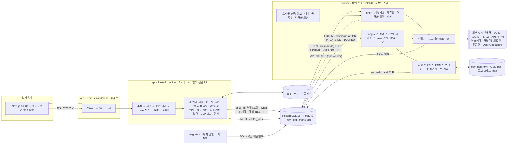

# 시스템 아키텍처



## 흐름

- **조회**: 브라우저는 같은 출처(`/api/v1`)만 부르고 Next 가 api 로 넘깁니다. 공간 연산은 PostGIS, 무거운 응답(GeoJSON·방문 여건)은
  Redis 에 데이터 버전 키로 캐시하고 ETag 로 재검증합니다.
- **쓰기(수집·계산)**: 관리 API·스케줄이 `ops.job` 에 넣으면 워커가 가져가 실행합니다. 수집이 끝나면 재계산 작업이 이어서 들어갑니다.
  계산은 한 트랜잭션에서 스냅샷 → 공간 조인 → 최근접 → 지표 → 생활 거점 → 은행 지점 영향 → 순위 → 품질 검사 순서로 돌고
  `calc_run` 단위로 보존됩니다. 계산이 끝나면 도보 계산(walk)이 이어서 같은 `calc_run` 에 도보 지표와 은행 지점 영향의 도보 열을 채웁니다.
- **무거운 작업은 자식 프로세스**: OSM 도보 그래프(꼭짓점 447만)를 다루는 osm·walk 작업은 spawn 자식 프로세스에서 돌아,
  끝나면 메모리를 모두 OS 에 돌려주고(유휴 워커 69MB) 자식이 죽어도 워커는 남습니다([ADR-019](adr/ADR-019-walking-access.md)).
- **보고서**: 지역 보고서는 서버에서 한 번에 묶고, 계산 결과 부분은 (calc_run, 도보 완료 시각) 키로 캐시합니다([ADR-020](adr/ADR-020-region-report.md)).
- **CSP 보고**: 브라우저가 막은 요청을 `/api/v1/csp-report` 로 알려 데이터·운영 오류 로그에 '보안 정책'으로 남습니다(외부 SDK 의 호스트 변경을 바로 앎).
- **차선**: 워커는 short·long 차선마다 스레드를 두고 자기 차선 종류만 가져갑니다. 도로 거리(25분)가 도는 동안에도 예보가 제때 갱신됩니다.
  차선 스레드는 30초마다 `ops.worker` 에 신호를 남기고, `/health`·데이터·운영 화면·compose healthcheck 가 이를 봅니다([ADR-017](adr/ADR-017-worker-lanes-ops.md)).
- **웹 캐시**: 지표 정의·지역 목록·GeoJSON 같은 조회는 브라우저 메모리 캐시(`cachedApi`, 1~10분)로 메뉴 이동 때 다시 받지 않고,
  서버는 ETag 로 한 번 더 막습니다. 조건이 바뀌면 진행 중인 요청을 취소하고(`useApi`), 주소의 조건을 반영한 뒤에만 요청합니다.
  지도 레이어는 옮길 때 화면 밖으로 나간 점만 지우고 새로 들어온 점만 만듭니다.
- **권한**: api 는 `atlas_api`(조회·What-if·작업 요청), worker·collector·migrate 는 소유자. raw(원본 응답)는 api 가 읽을 수 없습니다.

## 코드 계층 ([ADR-024](adr/ADR-024-code-layers.md))

```
api/routers (HTTP: 입력·상태 코드·헤더, SQL 없음)          web/pages·components (그리기)
      ↓                                                       ↓
features/<기능> (흐름·검증·캐시 + queries.py 의 SQL)          hooks/useApi·useKakaoMap·useBboxLayer (상태·부수효과)
      ↓                                                       ↓
domain (순수 규칙) · calc/runs · core · ops                   lib/api (클라이언트) · lib/choropleth·rules·mapGeom (순수 함수)
```

- 의존은 바깥 → 안쪽으로만 — `tests/unit/test_layers.py` 가 import 를 읽어 거꾸로 된 의존과 라우터 안 SQL 을 막습니다.
- 도메인 오류(`Invalid`·`NotFound`·`Conflict`)를 HTTP 상태로 바꾸는 곳은 `api/errors.py` 하나입니다.
- 수집기는 기존 자료를 지우기 전에 완전성을 확인하고, 한 번에 닫거나 지우는 양에 상한을 둡니다([ADR-023](adr/ADR-023-collector-data-guards.md)).

## 데이터 계층

| 스키마 | 내용 |
|---|---|
| `raw` | 외부 API 원문(키 마스킹, 1MB 이상 gzip) — 재처리·감사용 |
| `stg` | 수집 스냅샷(우체국) — 이력 병합 전 |
| `mart` | 시설 이력(SCD2), 행정구역·인구·집계구, 계산 결과(지표·최근접·순위·은행 지점 영향·도보), 은행 지점·브랜드, 예보, 약국·병의원, 공휴일, What-if |
| `ops` | 수집 실행, 품질 검사·이슈, 작업 큐, 워커 생존 신호, API 오류 로그 |

자세한 결정은 [ADR 목록](README.md#설계-결정-adr).
